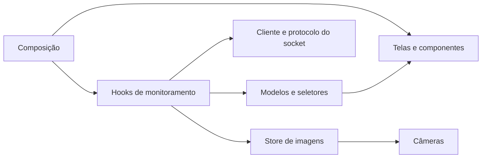

# Kairos — frontend

Painel de monitoramento em React, TypeScript e Vite: imagens do processamento, feed de notificações via WebSocket, filtros por plataforma, passageiros e exportação do histórico.

Na raiz do repositório, execute `iniciar.bat` para abrir backend e frontend juntos.

Para executar apenas o frontend:

```powershell
npm install
npm run dev
```

Abra `http://localhost:5173`. O painel recebe imagens, viagens e notificações do monitoramento local.

## Arquitetura

O projeto está organizado por funcionalidade. A aplicação compõe telas e navegação; o monitoramento reúne os componentes, regras e comunicação; os módulos compartilhados permanecem independentes do negócio.

```text
src/
  app/                       Composição, navegação e layout
  config/                    Configuração do ambiente
  features/monitoring/
    index.ts                 Interface pública da funcionalidade
    api/                     Cliente WebSocket e validação das mensagens
    components/              Câmeras, indicadores, filtros e notificações
    hooks/                   Conexão, filtros e seleção de notificações
    lib/                     Horário dos registros e exportação
    model/                   Tipos, índices e cálculos puros
    pages/                   Monitoramento, passageiros e histórico
  shared/
    lib/                     Utilitários genéricos
    ui/                      Ícones, títulos e estilos compartilhados
  styles/                    Tokens visuais e estilos base
```



- `app/App.tsx` escolhe a tela e conecta os componentes. A comunicação e os cálculos ficam na funcionalidade de monitoramento.
- `api/monitoringClient.ts` gerencia conexão, reconexão e encerramento. `protocol.ts` valida os dados recebidos antes de atualizar o estado.
- `model/selectors.ts` indexa viagens e passageiros, resolve destinatários e calcula indicadores sem depender de React ou de navegador.
- `useMonitoring` adapta o cliente ao ciclo de vida do React. `useMonitoringView` mantém filtros e seleção com resultados memorizados.
- Os frames usam um store separado. Cada câmera assina suas imagens por `useSyncExternalStore`, evitando renderizar listas e indicadores a cada frame.
- Telas recebem dados preparados e callbacks por propriedades. Cada componente possui seu próprio CSS Module.

Use `@/` nos imports entre camadas e imports relativos dentro da mesma funcionalidade. O TypeScript usa modo estrito e verifica acessos a índices. O ESLint impede dependências da interface no modelo e no transporte e impede que módulos compartilhados importem funcionalidades.

## Execução local

`iniciar.bat` abre os serviços locais e o painel em `http://127.0.0.1:5173`. O monitoramento permanece disponível após o vídeo; encerre as duas janelas com Ctrl+C. `iniciar.bat --check` confere os pré-requisitos.

O endereço padrão do socket é `ws://127.0.0.1:8765`. Para alterar, defina `VITE_WS_URL` em `.env.local`; veja `.env.example`. A configuração também pode reaproveitar o endereço local previamente salvo.

Mensagens JSON usam `{ "type": "snapshot" | "event" | "frame" | "status", "payload": ... }`. O snapshot contém programação, passageiros, histórico, status e últimas imagens. IDs são únicos por sessão, e a reconexão substitui o histórico para evitar duplicações. As câmeras recebem somente o vídeo anotado, com limite de 20 FPS condicionado ao processamento da máquina.

Os avisos registrados mostram a mensagem e os destinatários relacionados à viagem. A emissão do aviso não representa confirmação de entrega por um canal externo ou de embarque individual. Os dados e vídeos do repositório são exemplos para execução local.

## Verificação

```powershell
npm run build
npm run lint
npm run test:e2e
```

Os testes de navegador verificam filtros, destinatários, detalhes, atualização de imagens e eventos, rejeição de mensagens inválidas, duplicações e exportação. Usam papéis acessíveis e `data-testid`, sem depender das classes geradas pelos estilos. Os exemplos são enviados pelo socket interceptado apenas durante os testes; a aplicação recebe seus dados do monitoramento local.

Para preparar o navegador de teste, execute `npx playwright install chromium`. Para usar um Chrome já instalado, configure `PLAYWRIGHT_CHROME` com o caminho do executável.

As imagens de teste ficam em `tests/fixtures`. Para regenerá-las a partir dos vídeos, execute na raiz:

```powershell
.\Backend\venv\Scripts\python.exe Frontend/scripts/prepare_test_images.py
```

Prévias visuais geradas pelos testes ficam em `Frontend/preview`.
