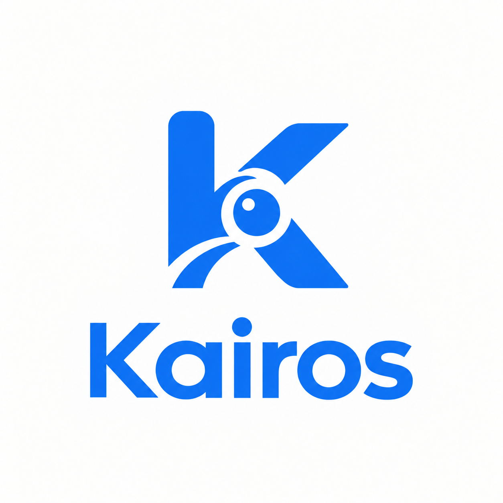

# Kairos

<p align="center">
  
</p>

<p align="center">
  <strong>O momento certo para transformar espera em confiança.</strong>
</p>

> Nossa proposta para o desafio da **ClickBus** no **FIAP Challenge 2026**: uma experiência de embarque mais clara, humana e previsível, conectada ao que realmente acontece no terminal.

## A espera também faz parte da viagem

Comprar uma passagem é simples; esperar pelo embarque ainda pode ser um momento de incerteza. O passageiro consulta horários previstos, mas nem sempre sabe se o ônibus já chegou, onde está ou quando deve se preparar para embarcar.

O **Kairos** reduz essa lacuna entre o planejamento e a realidade. A solução acompanha a operação no terminal, reconhece a chegada do veículo e transforma esse sinal em informação útil para quem vai viajar. Assim, plataformas como a ClickBus podem deixar de comunicar apenas uma previsão e passar a apoiar o passageiro no momento em que a viagem, de fato, começa.

## A nossa proposta

Kairos, do grego, *o momento certo*, é uma camada inteligente de monitoramento de embarque. Por meio de visão computacional, a solução identifica ônibus em vídeo, confere suas informações com a programação de viagens e confirma a chegada antes de gerar um evento para os passageiros daquela viagem.

Em vez de depender exclusivamente de horários estimados, o Kairos cria uma ponte entre o terminal e o aplicativo de venda de passagens: quando o ônibus chega, a plataforma ganha um sinal confiável para orientar o cliente.

## Uma experiência mais tranquila para todos

| Para o passageiro | Para a operação | Para a ClickBus |
| --- | --- | --- |
| Mais previsibilidade e menos ansiedade no período de espera. | Visibilidade sobre a chegada dos veículos e base para comunicações mais coordenadas. | Uma jornada digital que permanece útil até o embarque, fortalecendo confiança e relacionamento. |
| Informação contextual no momento de se preparar para embarcar. | Redução da dependência de avisos manuais e possibilidade de acompanhar eventos em tempo real. | Diferencial de experiência com potencial para notificações, status da viagem e atendimento proativo. |

## Como o Kairos gera valor

1. **Observa a chegada:** câmeras ou fluxos de vídeo acompanham a área de embarque.
2. **Reconhece o veículo:** a solução detecta o ônibus e lê elementos visíveis, como empresa e prefixo.
3. **Confirma a viagem:** as evidências são comparadas à programação para evitar associações incorretas.
4. **Aciona a jornada:** após a confirmação, um evento de chegada pode alimentar notificações e experiências no aplicativo.

O resultado é uma comunicação mais relevante: a pessoa recebe a informação quando ela realmente importa, em vez de ter de procurar atualizações ou esperar sem contexto.

## Do terminal para a palma da mão

```text
Ônibus chega ao terminal
          ↓
Kairos identifica e valida o veículo
          ↓
Chegada confirmada para a viagem
          ↓
ClickBus informa os passageiros certos, no momento certo
```

Essa arquitetura abre espaço para evoluções como alertas de embarque, orientação para plataforma, acompanhamento operacional e integrações com canais de atendimento — sempre partindo de um evento real, detectado no ambiente do terminal.

## Protótipo funcional

Esta entrega apresenta um fluxo completo de prova de conceito: detecção e rastreamento de ônibus, leitura de informações visíveis, validação com a grade de viagens e emissão de um evento de chegada associado aos passageiros da viagem.

Os vídeos, horários e cadastros utilizados na demonstração são **dados simulados**. A proposta, porém, foi estruturada para que a fonte de vídeo possa evoluir de um arquivo de demonstração para câmeras locais ou streams RTSP em um cenário operacional.

## Documentação técnica

Os detalhes de instalação, execução, arquitetura e tecnologias estão separados por camada:

- [Backend — visão computacional e processamento](/Backend/README.md)
- [Frontend — interface da experiência](/Frontend/README.md)

---

<p align="center">
  <strong>Kairos</strong><br />
  Informação certa. No momento certo.
</p>
